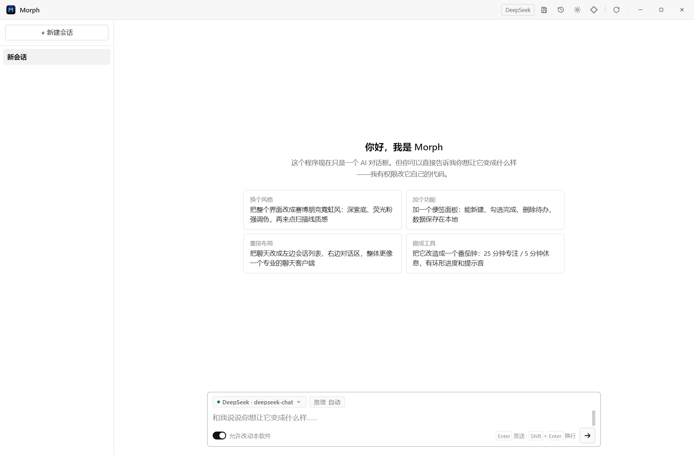
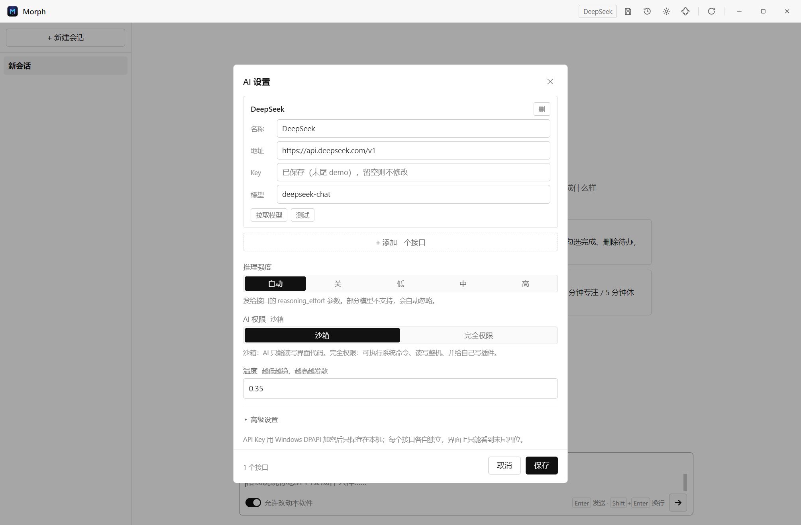

# Morph · 可以被 AI 改写的桌面程序

> 它出厂时只是一个 AI 对话框。然后你说想要什么，它就把自己改成什么样。

Morph 是一个 Windows 桌面程序，理念只有一条：**软件本身是可写的**。

它把你的界面（HTML / CSS / JS）放在一个普通文件夹里，而跟你聊天的那个 AI，拥有直接读写这些文件的工具权限。所以"换个配色""重排布局""加一个便签板""改造成番茄钟"这类需求，不再需要开发者——AI 说完就动手改代码，界面立刻重载成新的样子。



窗口控件、模型名、保存 / 版本 / 插件 / 设置都长在 **Windows 标题栏**上，界面本体是左侧会话栏 + 右侧聊天区；标题栏属于程序本体（不在 `ui/` 里），AI 改不到，所以永远点得到。

界面默认是白底黑字的朴素风格 —— 因为它只是"出厂形态"，你随时可以让 AI 把它改成任何样子。

---

## 下载

Windows 10 / 11 x64，装好即用，不需要管理员权限：

| 文件 | 说明 |
| --- | --- |
| [Morph-1.0.0-setup.exe](https://github.com/Cross389/Morph/releases/latest/download/Morph-1.0.0-setup.exe) | 安装版：可选安装目录，建桌面 / 开始菜单快捷方式 |
| [Morph-1.0.0-portable.exe](https://github.com/Cross389/Morph/releases/latest/download/Morph-1.0.0-portable.exe) | 便携版：双击即用，不需要安装 |
| [SHA256SUMS.txt](https://github.com/Cross389/Morph/releases/latest/download/SHA256SUMS.txt) | 上面两个文件的校验值 |

上面的链接直接指向最新版安装包（`releases/latest/download/…`），点开就下载；历史版本在 [Releases](https://github.com/Cross389/Morph/releases) 页面。首次启动会引导你填 API Key。

**安装版和便携版怎么选？** 两者功能完全一样，只是安装方式不同：

- **安装版（setup）**：走安装向导，可以自己选安装目录；装完有桌面 / 开始菜单快捷方式，能从「应用和功能」里正常卸载。卸载**不会**删掉你的会话和设置。
- **便携版（portable）**：单个 exe，双击就用；不写注册表、不建快捷方式、不需要管理员权限，适合放 U 盘或临时试用。注意：**数据仍然存在 `%APPDATA%\Morph`**；想要完全绿色（数据跟着 exe 走），启动时加参数 `Morph.exe --user-data=D:\某个目录`。

## 快速开始

### 用安装包（推荐）

从 [Releases](https://github.com/Cross389/Morph/releases/latest) 下载 `Morph-1.0.0-setup.exe`（安装版）或 `Morph-1.0.0-portable.exe`（便携版），双击运行即可。

### 从源码运行

```powershell
npm install
npm start          # 开发运行
npm run dist       # 打包 安装版 + 便携版（输出在 release/）
```

需要 Node.js 18+。

---

## 一、先配置 AI

点标题栏的 ⚙（或输入框里的「管理接口与 Key…」），可以**同时添加多个接口**，每个接口各自一套地址 + Key：

1. **名称 + 接口地址（Base URL）** —— 任何 OpenAI 兼容接口，通常以 `/v1` 结尾
2. **API Key** —— 各自的 Key，互不影响
3. **模型** —— 点「拉取模型」会向该接口要一份可用列表（`GET /v1/models`），也可以直接手填

配好之后，**输入框上方**会出现两个小药丸：

- **模型** —— 点开就是所有接口下的模型清单，按接口分组，点一下就切换
- **推理强度** —— 自动 / 关 / 低 / 中 / 高，对应发出去的 `reasoning_effort`；不支持的模型会自动忽略

本机跑 Ollama / LM Studio 也能用（地址填 `http://127.0.0.1:11434/v1` 之类，Key 随便填）。

设置里的「高级设置」还有两项可以调：

- **单次最大 token**：发给接口的 `max_tokens`（单次**输出**上限）。填 `0` 表示不发送，交给模型厂商自己的默认/上限；也可以填任意正整数，但超过厂商能力会被服务端拒绝或截断。注意它和**上下文窗口**（输入+输出）是两回事。
- **单次工具调用上限**：一条消息里 AI 最多连续调用多少次工具，默认 40，大于 0 的整数都可以。调大适合大规模改造，但更慢、更费钱。

> 每个 Key 都用 Windows DPAPI 加密后存在 `%APPDATA%\Morph\settings.json`，界面上只能看到"末尾四位"，AI 自己也读不到明文。

---

## 二、让 AI 改软件自己

在输入框里直接说人话，比如：

| 你说 | AI 会做的事 |
| --- | --- |
| 把界面换成赛博朋克霓虹风 | 改写 `ui/style.css` 的配色/发光/扫描线，`reload_ui` 生效 |
| 左边加会话列表，右边聊天 | 重写 `ui/index.html` + `ui/app.js` 的布局与会话管理 |
| 加一个便签面板，能勾选完成 | 新建组件 + 用 `morph.kv` 持久化数据 |
| 把它改成番茄钟 | 整站重写成一个计时器应用 |
| 再改回聊天 | 从版本历史里回滚，或者让它重写 |

它动手时会显示工具调用标签（`read_file` / `write_file` / `reload_ui` …），改完界面自动刷新。

**同一次对话里，你的聊天记录不会丢**：界面文件被改写导致重载后，会话从本地存储恢复，最后一句回复也会补回来。

---

## 三、改坏了怎么办

改坏了有退路 —— 但前提是**你自己存过版本**：

1. **版本由你手动存** —— 点右上角 💾（或「版本管理 → 保存当前版本」）把现在的界面存成一份版本，之后可以改名、删除、随时恢复。程序不会在你看不见的地方自动备份，存不存完全由你决定。
2. **崩溃兜底** —— 界面脚本报错时，左下角出现一条红色提示（版本管理 / 重新加载）；整个界面白屏时，中间会弹出兜底卡片（版本管理 / 恢复出厂 / 重新加载）。
3. **版本管理弹窗** —— 标题栏的 🕘 或 `Ctrl+Shift+M`。它由外壳提供、不依赖被改写的界面，白屏时也能存 / 恢复 / 删除 / 改名版本。
4. **出厂基线是锁死的** —— 「恢复出厂」指向 `%APPDATA%\Morph\master\` 里的一份副本：AI 的文件工具被硬性禁止访问它，只有标题栏 🕘 →「设为出厂」（二次确认）能把它更新成当前界面。所以你随时能一键回到某个确定的、没被 AI 动过的样子。
5. **安全模式** —— 启动参数加 `--safe-mode`，直接加载出厂基线。
6. **只读保护** —— 不允许通过工具/界面访问 `settings.json`、`snapshots/` 与 `master/`。

版本管理：保存、改名、删除、恢复、设为出厂、恢复出厂都在这个弹窗里。界面被写坏时，左下角那条提示也能直接打开它。



界面脚本报错时，底部会浮出这条提示（由注入的桥接层提供，不依赖页面自己的代码）：


---

## 四、它是怎么实现的

```text
electron/
  main.js              主进程：窗口、自定义协议、IPC、AI 调度
  preload-shell.js     外壳的 IPC 桥
  bridge/iframe.js     注入到用户界面的 window.morph 桥
  core/
    paths.js           数据目录（%APPDATA%\Morph）
    settings.js        设置 + DPAPI 加密的 API Key
    ai.js              OpenAI 兼容的流式对话（SSE + tool_calls 解析）
    agent.js           自省循环：模型 ↔ 工具，最多 16 步
    tools.js           内置工具（含 append_file 分段写入、run_command）
    fsx.js             文件访问层（沙箱 / 完全权限两种模式）
    snapshots.js       版本的保存 / 恢复 / 改名 / 删除
    plugins.js         插件扫描 / 开关 / 删除
    exec.js            PowerShell 执行（仅完全权限）
    seed.js            首次启动铺设模板 + 出厂基线
renderer/              外壳：标题栏（含版本管理弹窗）+ 界面容器（不在 ui/ 里，AI 改不到）
template/              出厂界面，首次启动复制到用户目录
```

关键设计：

- **界面跑在独立 origin**（`morph://ui/`），通过 `postMessage` 与外壳通信，拿不到 Node、拿不到文件系统之外的任何东西。
- **AI 的工具调用直接落到真实文件**，所以"改软件"这件事就是普通的写文件——不需要插件协议、不需要编译。
- **重载时机**：工具执行 `reload_ui` 时不立刻刷新，等这一轮回答输出完再刷新，避免回复被吞掉。
- **系统提示词**里给了文件地图、桥接 API、设计规范与硬性规则（不要删桥接、改完要 reload、先读再改）。

完整桥接 API 见 `template/docs/BRIDGE.md`（运行时在 `%APPDATA%\Morph\docs\BRIDGE.md`）。

---

## 五、权限：沙箱 / 完全权限

设置里的「AI 权限」有两档，**默认沙箱**：

| | 沙箱（默认） | 完全权限 |
| --- | --- | --- |
| 文件 | 只能读写 `%APPDATA%\Morph` 里的界面代码 | 整台电脑任意路径 |
| 命令 | 不能执行 | `run_command`（PowerShell），可运行程序、装包 |
| 工具 | 固定的 15 个（含 `find_files` / `search_files` / 带请求体的 `fetch_url`） | 额外获得 `run_command`、`plugins_reload`，以及你自己写的插件 |

**完全权限下 AI 可以给自己写工具**：往 `%APPDATA%\Morph\plugins\xxx.js` 写一个模块，然后调用 `plugins_reload` 就立刻生效。

```js
// plugins/hello.js
module.exports = {
  name: 'hello_morph',
  description: '打个招呼',
  parameters: { type: 'object', properties: { to: { type: 'string' } } },
  run: async (args, ctx) => ({ greeting: `hello ${args.to || 'world'}` }),
};
```

`run(args, ctx)` 里的 `ctx` 提供 `fs / exec / fetch / kv / paths`。

> 出厂界面只做最简聊天，**不带图片输入**。需要识图时，让 AI 写一个工具插件（参考 `ocr-image.js`：传图片路径、返回文字），或自己扩展界面。

> 即使在完全权限下，`settings.json`（含加密 Key）、`snapshots/`、`master/` 依然禁止工具访问 —— 这三个是"程序完整性"的底线，放开它们只会让 AI 有机会破坏回滚能力和泄漏 Key，没有任何实际能力提升。

---

## 六、数据目录

```text
%APPDATA%\Morph\
  ui\            界面代码（AI 改的就是这里）
  shell\         外壳样式覆盖（可选 override.css）
  docs\          BRIDGE.md
  notes\         PROJECT.md —— AI 的项目笔记
  assets\        图片等资源
  data\          kv.json / last-reply.json
  snapshots\     快照
  settings.json  设置（Key 已加密）
```

AI 给出的路径都是相对这个目录的，例如 `ui/style.css`、`assets/logo.svg`。

想让软件真正"搬走"或做多套配置：

```powershell
Morph.exe --user-data=D:\MyMorph
```

---

## 七、安全边界

- 渲染进程 `nodeIntegration: false` + `contextIsolation: true`。
- 用户界面是 sandbox iframe，只有 `postMessage` 一条通道。
- 文件访问全部经过 `fsx` 的路径越界检查，且禁止触碰 `settings.json`、`snapshots/`。
- AI 工具没有命令执行能力——它只能写前端的 HTML/CSS/JS，跑不了任意系统命令。
- Key 走 DPAPI；界面上只有 `hasKey` / `keyTail`。

---

## 八、已知限制

- AI 没"眼睛"：它改完看不到渲染结果（可以让它读回自己的源码来检查）。
- 单轮任务有工具调用步数上限（默认 40，可在「高级设置」里改成任意大于 0 的整数）：复杂改造可能停在中途，回一句「继续」就会接着做。
- 只支持 OpenAI 兼容协议（Anthropic 原生协议可通过兼容网关接入）。
- 生成过程没有"暂停/恢复"，长任务中途失败只能继续或重来。
- 界面被改后，出厂界面文件不会自动更新（这正是定制的前提）。

---

MIT License


